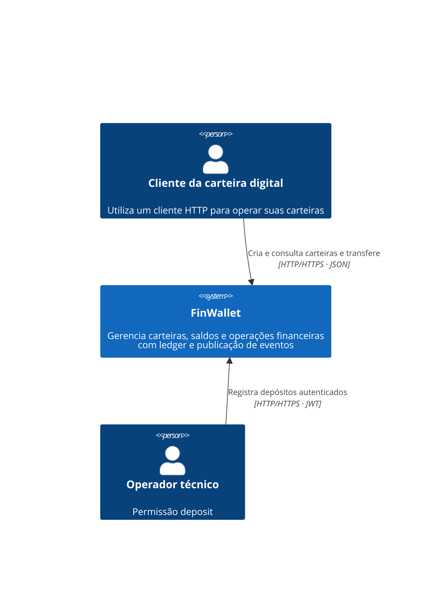
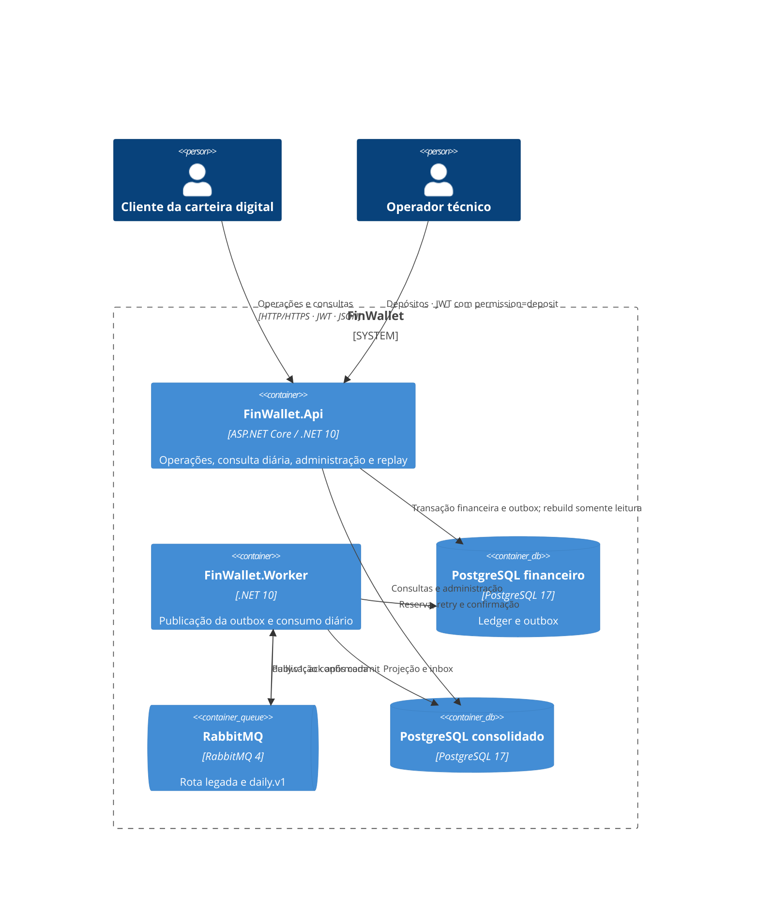
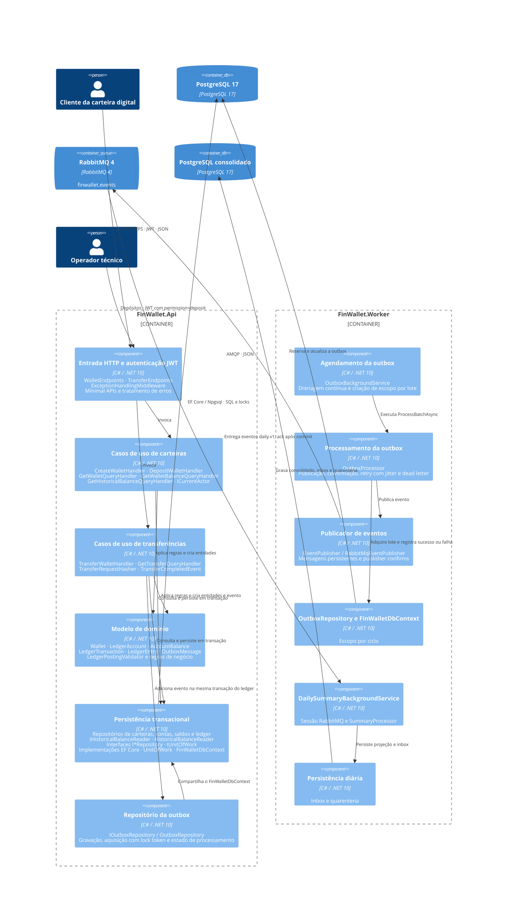

# FinWallet

As decisões da solução estão no [catálogo de ADRs](docs/adr/README.md), com contexto, alternativas, consequências e distinção entre implementação atual e evolução proposta.

API de carteiras digitais desenvolvida em C# e .NET 10, com persistência em PostgreSQL e publicação de eventos no RabbitMQ. O projeto utiliza um ledger com partidas de débito e crédito para registrar transferências, controle de concorrência sobre saldos e o padrão Transactional Outbox.

O consolidado diário tem banco próprio e módulos separados de Application e Infrastructure. Suas rotas de consulta e administração ficam na `FinWallet.Api`; o consumidor compartilha o `FinWallet.Worker` com a publicação da outbox. O saldo histórico continua como consulta síncrona ao ledger.

## Estado atual

- Criação de carteira com conta contábil e saldo inicial zero, em uma única transação.
- Transferência entre carteiras ativas da mesma moeda, com validação do proprietário da origem.
- Idempotência de transferências por cliente e chave, com verificação dos dados da requisição.
- Atualização transacional dos saldos e registro das partidas contábeis.
- Outbox transacional para depósitos e transferências (`ledger.posted.v1`) e metadados (`wallet.registered.v1`), preservando `TransferCompletedEvent`.
- Consolidado diário UTC por carteira/moeda, inbox, quarentena, replay e reconstrução por geração com reconciliação.
- Processamento da outbox em segundo plano, com bloqueio temporário, novas tentativas com atraso exponencial e jitter, e marcação como dead letter após o limite de falhas.

A API autentica tokens Bearer RS256, deriva o cliente da claim `customer_id` e isola consultas e movimentações por proprietário. Depósitos exigem a permissão técnica `deposit`. O saldo histórico é agregado a partir do ledger.

## Tecnologias e estrutura

- .NET 10, C# 14 e ASP.NET Core Minimal APIs.
- Entity Framework Core 10 e Npgsql.
- PostgreSQL 17 e RabbitMQ 4.
- xUnit e Coverlet para testes e coleta de cobertura.

```text
src/
  FinWallet.Worker/          Publicação da outbox, consumo da projeção e health checks
  FinWallet.Api/             Endpoints, contratos HTTP e tratamento de erros
  FinWallet.Application/     Casos de uso, interfaces e processamento da outbox
  FinWallet.Domain/          Entidades, regras de negócio, CurrencyCode e validações do ledger
  FinWallet.Infrastructure/  Persistência, migrations, RabbitMQ e worker
tests/
  FinWallet.UnitTests/       Testes de domínio, outbox e serviço em segundo plano
  FinWallet.IntegrationTests/ Testes de persistência, concorrência, HTTP e recuperação
  FinWallet.ValidationHost/   Host de falhas, verificadores e ensaios de carga
```

## Arquitetura C4

Os diagramas descrevem a implementação atual e usam Mermaid para renderização no GitHub. A sintaxe nativa `C4Context`, `C4Container` e `C4Component` representa os três níveis do modelo C4; as setas representam interações e dependências, com o protocolo quando há comunicação entre processos.

### Nível 1 — Contexto do sistema

O cliente autenticado interage diretamente com a API para criar e consultar suas carteiras, consultar saldos atuais e históricos e realizar ou consultar transferências. A identidade técnica registra depósitos. Há consumidor do consolidado; frontend e provedor externo de pagamentos permanecem fora do escopo. PostgreSQL e RabbitMQ são detalhados no nível de contêineres como parte da solução.



Em Development, a API prepara identidades locais e assina tokens RSA quando não há autenticação configurada. A validação verifica assinatura, emissor, audiência, validade, `sub` e `customer_id`. A chave privada fica em artefatos locais ignorados pelo Git. Em produção, um provedor de identidade deve assumir emissão e ciclo de vida das credenciais.

### Nível 2 — Contêineres

No C4, um contêiner representa uma aplicação ou armazenamento em execução, e não necessariamente um contêiner Docker. `FinWallet.Api` atende HTTP e grava a outbox; `FinWallet.Worker` publica a outbox e consome a projeção diária. Application, Domain e Infrastructure são bibliotecas compartilhadas.



O Docker Compose inicia PostgreSQL e RabbitMQ; API e worker são iniciados separadamente pelo .NET. O PostgreSQL de testes não participa do fluxo da aplicação. A fila `.daily.v1` possui consumidor independente; a rota legada permanece disponível para integrações.

### Nível 3 — Componentes da API e do worker

O detalhamento abaixo mostra os processos da API e do worker. Componentes afins estão agrupados para facilitar a leitura; os nomes correspondem às classes e abstrações do código.



- **Transação financeira:** os handlers de depósito e transferência validam as partidas diretamente com `LedgerPostingValidator` e usam `IUnitOfWork` para persistir as alterações atomicamente. Somente a transferência registra `TransferCompletedEvent` na outbox.
- **Publicação assíncrona:** o `FinWallet.Worker` consulta a outbox em processo próprio. O processamento pode repetir uma publicação; o consumidor do consolidado trata duplicatas com inbox transacional. A marcação de dead letter permanece no PostgreSQL.
- **Serviço adicional:** `LedgerPostingService` está implementado e registrado na injeção de dependências, mas não é chamado pelos handlers atuais e, por isso, não aparece no fluxo do diagrama.

As interfaces de persistência e mensageria ficam em Application, e suas implementações em Infrastructure. Domain concentra as entidades e regras de negócio. O ponto de composição em `Program.cs` registra os serviços de Application e Infrastructure.

## Executar localmente

### Pré-requisitos

- SDK do .NET 10.
- Docker com Docker Compose.
- Ferramenta `dotnet-ef` compatível com EF Core 10 para aplicar as migrations.

Execute os comandos a partir da raiz do repositório.

Para o uso local, depois de preparar a infraestrutura e aplicar as migrations nas etapas abaixo, inicie a API com um único comando:

```bash
dotnet run --project src/FinWallet.Api --launch-profile http
```

Em Development, sem configuração explícita de autenticação, a própria API gera ou reutiliza a chave RSA local e prepara tokens de demonstração em `artifacts/auth/`. Não é necessário executar scripts, Python, OpenSSL ou `source` para iniciar a API. JWT e autorização continuam habilitados. Fora de Development, a configuração de autenticação é obrigatória. PostgreSQL e RabbitMQ precisam estar disponíveis; o comando não aplica migrations nem inicia os contêineres.

### 1. Iniciar a infraestrutura

```bash
docker compose up -d --wait postgres rabbitmq
```

O Compose inicia as dependências. A API é executada separadamente pelo .NET.

| Serviço | Endereço | Usuário | Senha de desenvolvimento |
| --- | --- | --- | --- |
| PostgreSQL | `localhost:5432`, banco `finwallet` | `finwallet` | `finwallet_dev` |
| RabbitMQ (AMQP) | `localhost:5672` | `finwallet` | `finwallet_dev_password` |
| Painel RabbitMQ | <http://localhost:15672> | `finwallet` | `finwallet_dev_password` |

Essas credenciais são destinadas ao ambiente local. Para encerrar os serviços preservando os volumes, execute `docker compose down`.

### 2. Restaurar e preparar o banco

```bash
dotnet restore FinWallet.slnx
dotnet tool install --global dotnet-ef --version 10.0.4
```

Se a ferramenta já estiver instalada, verifique a versão com `dotnet ef --version`. A autenticação de desenvolvimento é preparada pela própria API, sem configuração manual.

Aplique as migrations usando o ambiente de desenvolvimento no mesmo terminal:

```bash
dotnet ef database update \
  --project src/FinWallet.Infrastructure \
  --startup-project src/FinWallet.Api \
  --context FinWalletDbContext \
  -- --environment Development
```

As migrations não são aplicadas automaticamente ao iniciar a API.

### 3. Iniciar a API

Inicie diretamente pelo .NET:

```bash
dotnet run --project src/FinWallet.Api --launch-profile http
```

Para usar outro emissor, configure explicitamente `Authentication__Issuer`, `Authentication__Audience` e `Authentication__PublicKeyPem`. Configurações parciais geram erro, sem substituir os valores informados.

Os tokens locais expiram em uma hora e são renovados ao iniciar a API sem configuração explícita de autenticação. A chave privada e os tokens ficam em `artifacts/auth/`, ignorado pelo Git, com acesso restrito ao usuário local. O bootstrap com acesso à chave privada só ocorre em Development; a validação JWT usa a chave pública. Execute `source artifacts/auth/demo.env` nos terminais usados para as chamadas HTTP; isso não é necessário para iniciar a API.

A API estará disponível em <http://localhost:5184>. O perfil `http` define `ASPNETCORE_ENVIRONMENT=Development` e carrega as configurações locais.

- Verificação da aplicação: <http://localhost:5184/health>.
- Documento OpenAPI em desenvolvimento: <http://localhost:5184/api/v1/openapi/v1.json>.

As rotas da API, incluindo administração e OpenAPI, usam o prefixo `/api/v1`. As rotas de health permanecem sem versão. Não há interface Swagger UI configurada.

`/health/live` verifica se o processo responde; `/health/ready` verifica a conexão com o banco financeiro; `/health/summary/ready` verifica a disponibilidade e inicialização da projeção diária. Essas verificações são distintas e permitem detectar indisponibilidade das dependências sem confundi-la com falha do processo. `/health` retorna um status estático e é redundante com `/health/live`; foi preservado por compatibilidade.

Para usar o perfil `https`, configure um certificado de desenvolvimento confiável e execute `dotnet run --project src/FinWallet.Api --launch-profile https`. A URL HTTPS desse perfil é `https://localhost:7111`.

### 4. Preparar e iniciar o consolidado diário

`FinWallet.Api` reúne as rotas financeiras, a consulta do resumo diário e a administração. `FinWallet.Worker` publica a outbox e consome os eventos da projeção diária. Os módulos DailySummary de Application e Infrastructure e os bancos permanecem separados. A API não inicia serviços em segundo plano nem aplica migrations automaticamente; informe `--context` nos comandos EF.

A configuração local da API fica em `src/FinWallet.Api/appsettings.Development.json`: `FinWallet`, `DailySummary` (papel `summary_admin`) e `LedgerReadOnly`. O Worker mantém sua própria configuração: `FinWallet` com acesso à outbox, `DailySummary` com o papel `summary_consumer`, `RabbitMq`, `Outbox` e `OutboxWorker`; não requer JWT nem `LedgerReadOnly`.

A autenticação local é preparada pelo próprio .NET, usando a mesma chave da API financeira em `artifacts/auth/`. Não é necessário executar Python nem carregar `demo.env` para iniciar os processos. Configurações explícitas de autenticação continuam sendo respeitadas; fora de Development, issuer, audience e chave pública são obrigatórios.

Para um banco já criado pelo migrador SQL, conclua primeiro a adoção validada para EF Core. Não execute a migration inicial diretamente sobre tabelas existentes.

Na raiz do repositório, prepare um banco novo exclusivo do consolidado (porta `5434`):

```bash
docker compose up -d --wait postgres rabbitmq summary-postgres
ConnectionStrings__DailySummary="Host=localhost;Port=5434;Database=finwallet_daily;Username=finwallet_daily;Password=finwallet_daily_dev" \
  dotnet ef database update --project src/FinWallet.Infrastructure --startup-project src/FinWallet.Api --context DailySummaryDbContext -- --environment Development
```

As identidades de runtime recebem os papéis NOLOGIN criados pelas migrations. A API unificada usa `summary_admin` para consulta e administração; o Worker usa `summary_consumer`. A conexão `LedgerReadOnly` da API deve permitir apenas leitura do ledger. Para migrations/adoção, forneça explicitamente `ConnectionStrings__DailySummary` com a identidade proprietária. O comando `--adopt-schema` dispensa as demais conexões, JWT e RabbitMQ. Rebuild e consumo podem executar simultaneamente com a coordenação por locks existente.

Para provisionar o login de consumo no ambiente local com a senha de desenvolvimento configurada no Worker, execute após as migrations:

```bash
docker compose exec -T summary-postgres psql -v ON_ERROR_STOP=1 -U finwallet_daily -d finwallet_daily < scripts/sql/provision-local-summary.sql
```

O script cria o login ausente e concede somente o papel de consumo; não troca a senha de um login já existente. Para ambientes externos, escolha senhas próprias.

Por exemplo, no banco local da projeção, execute como proprietário e escolha senhas próprias:

Na raiz do repositório, abra o `psql` pelo Docker Compose:

```bash
docker compose exec summary-postgres psql -v ON_ERROR_STOP=1 -U finwallet_daily -d finwallet_daily
```

No prompt do `psql`, execute:

```sql
CREATE ROLE summary_local_reader LOGIN PASSWORD '<senha-reader>' IN ROLE summary_reader;
CREATE ROLE summary_local_consumer LOGIN PASSWORD '<senha-consumer>' IN ROLE summary_consumer;
CREATE ROLE summary_local_admin LOGIN PASSWORD '<senha-admin>' IN ROLE summary_admin;
```

No banco financeiro `finwallet` (porta `5432`), execute como proprietário, após as migrations da etapa 2, para criar o login usado no rebuild:

Saia da sessão anterior com `\q` e abra o `psql` do banco financeiro:

```bash
docker compose exec postgres psql -v ON_ERROR_STOP=1 -U finwallet -d finwallet
```

No prompt do `psql`, execute:

```sql
CREATE ROLE summary_local_ledger_reader LOGIN PASSWORD '<senha-ledger-reader>';
GRANT CONNECT ON DATABASE finwallet TO summary_local_ledger_reader;
GRANT USAGE ON SCHEMA public TO summary_local_ledger_reader;
GRANT SELECT ON TABLE public.wallets, public.ledger_accounts,
  public.ledger_transactions, public.ledger_entries TO summary_local_ledger_reader;
```

Ao terminar, use `\q` para sair do `psql` e voltar ao terminal.

Substitua os placeholders das conexões abaixo por connection strings Npgsql completas, usando os logins e as senhas escolhidos. Por exemplo: `Host=localhost;Port=5434;Database=finwallet_daily;Username=summary_local_admin;Password=<senha-admin>`. Para `LedgerReadOnly`, use a porta `5432`, o banco `finwallet` e o login `summary_local_ledger_reader`.

Inicie a API unificada em um terminal, na porta `5184` (se já estiver em execução, reinicie-a com estas conexões):

```bash
ConnectionStrings__DailySummary="<conexão-summary_local_admin>" \
ConnectionStrings__LedgerReadOnly="<conexão-login-leitura-ledger>" \
  dotnet run --project src/FinWallet.Api --launch-profile http
```

Faça o bootstrap inicial em outro terminal. As migrations financeiras da etapa 2 já devem ter sido aplicadas. Esta chamada autenticada reconstrói a projeção a partir de um snapshot do ledger, inclusive vazio. O `source` abaixo serve apenas para obter o token da chamada administrativa, não para inicializar a API:

```bash
source artifacts/auth/demo.env
curl --fail-with-body -X POST http://localhost:5184/api/v1/admin/rebuild \
  -H "Authorization: Bearer $SUMMARY_ADMIN_TOKEN"
```

Inicie o Worker em outro terminal, com o login de consumo e sua senha escolhida acima, e health checks na porta `5187`:

```bash
ConnectionStrings__DailySummary="<conexão-summary_local_consumer>" \
  dotnet run --project src/FinWallet.Worker --launch-profile http
```

Mantenha a API financeira e os processos do consolidado ativos durante o teste. Confira HTTP 200 na prontidão antes da carga:

```bash
curl --fail-with-body http://localhost:5184/health/summary/ready
curl --fail-with-body http://localhost:5187/health/ready
SUMMARY_BASE_URL=http://localhost:5184 bash scripts/k6/run.sh daily-summary
```

HTTP 503 pode indicar migrations/bootstrap pendentes, banco indisponível ou, no consumidor, ausência de conexão com o broker. Falha de conexão indica que o processo não está acessível na porta informada. O worker verifica também o acesso ao banco financeiro. Readiness não comprova publicação recente da outbox: verifique os logs de ciclos e publicação; fila vazia não é falha. Veja os critérios de carga em [scripts/k6/README.md](scripts/k6/README.md).

Use o proprietário do banco apenas para migrations/adoção. Em runtime, a API usa um login com `summary_admin` e o Worker usa outro com `summary_consumer`; a conexão `LedgerReadOnly` deve permitir apenas leitura do ledger. Variáveis de ambiente podem sobrescrever as configurações dos arquivos.

## Configuração

As configurações locais estão em `src/FinWallet.Api/appsettings.Development.json`. Elas podem ser sobrescritas por variáveis de ambiente, usando `__` para separar as seções.

| Variável | Valor local | Finalidade |
| --- | --- | --- |
| `ConnectionStrings__FinWallet` | `Host=localhost;Port=5432;Database=finwallet;Username=finwallet;Password=finwallet_dev` | Conexão com o banco |
| `ConnectionStrings__DailySummary` | Login `summary_local_admin`, porta `5434` | Consulta e administração da projeção |
| `ConnectionStrings__LedgerReadOnly` | Login `summary_local_ledger_reader`, porta `5432` | Leitura financeira para rebuild |
| `RabbitMq__HostName` | `localhost` | Host do RabbitMQ |
| `RabbitMq__Port` | `5672` | Porta AMQP |
| `RabbitMq__UserName` | `finwallet` | Usuário do broker |
| `RabbitMq__Password` | `finwallet_dev_password` | Senha do broker |
| `RabbitMq__QueueName` | `finwallet.events` | Fila de eventos |
| `Authentication__Issuer` | `finwallet-local` | Emissor confiável do token |
| `Authentication__Audience` | `finwallet` | Audiência exigida |
| `Authentication__PublicKeyPem` | Gerado localmente | Chave pública RSA em PEM |
| `Outbox__BatchSize` | `100` | Quantidade de mensagens por lote |
| `Outbox__MaxAttempts` | `5` | Limite de tentativas antes de marcar como dead letter |
| `Outbox__LockDuration` | `00:02:00` | Duração do bloqueio de processamento |
| `Outbox__InitialRetryDelay` | `00:00:05` | Base inicial do atraso entre tentativas |
| `Outbox__MaxRetryDelay` | `00:05:00` | Teto do atraso entre tentativas |
| `OutboxWorker__PollingInterval` | `00:00:05` | Espera quando a outbox está vazia ou há falha no lote; lotes bem-sucedidos são drenados continuamente |

No ambiente local, os pools financeiros são limitados a 40 conexões na API e 10 no Worker; o acesso de rebuild tem limite de 5. Esses limites deixam margem no PostgreSQL local de 100 conexões para administração e outros processos. Ao aumentar réplicas, dimensione a soma dos pools de todos os processos. O publicador mantém conexão e canal AMQP entre lotes, serializa as publicações e recria a sessão após falhas, preservando confirmações e identificadores. Depois das confirmações do broker, a outbox confirma as reservas em lote, verificando token e validade de cada uma. A projeção agrupa as posições em um batch SQL dentro da transação da inbox; falha de metadados desfaz todos os efeitos. O Worker local usa `DailySummary__PrefetchCount=16`, mantendo processamento sequencial e ack individual após commit.

As opções `RabbitMq`, `Outbox` e `OutboxWorker` pertencem ao `FinWallet.Worker`. Fora do ambiente `Development`, forneça as conexões dos bancos de cada host e as configurações do RabbitMQ do worker por uma fonte de configuração apropriada, pois elas não estão no `appsettings.json` base.

## Endpoints

| Método | Rota | Comportamento atual |
| --- | --- | --- |
| `GET` | `/health` | Retorna o status estático da aplicação (compatibilidade) |
| `GET` | `/health/live` | Verifica se o processo responde |
| `GET` | `/health/ready` | Verifica conexão com o banco financeiro |
| `GET` | `/health/summary/ready` | Verifica disponibilidade e inicialização da projeção diária |
| `GET` | `/api/v1/wallets/{walletId}/daily-summary?date=YYYY-MM-DD` | Consulta autenticada do resumo diário do proprietário |
| `GET` | `/api/v1/admin/status` | Status da projeção; exige `summary.admin` |
| `POST` | `/api/v1/admin/outbox/{messageId}/replay` | Reprocessa mensagem da outbox; exige `outbox.admin` |
| `POST` | `/api/v1/admin/rebuild` | Reconstrói a projeção; exige `summary.admin` |
| `POST` | `/api/v1/admin/quarantine/{id}/replay` | Reprocessa evento em quarentena; exige `summary.admin` |
| `POST` | `/api/v1/wallets/` | Cria uma carteira e retorna seu UUID com HTTP 200 |
| `GET` | `/api/v1/wallets/{walletId}` | Consulta a carteira; retorna 404 se não existir |
| `GET` | `/api/v1/wallets/{walletId}/balance` | Consulta os saldos contábil, reservado e disponível; retorna 404 se a carteira não existir |
| `GET` | `/api/v1/wallets/{walletId}/balance/history?at=<ISO-8601>` | Saldo contábil histórico do proprietário, com offset obrigatório |
| `POST` | `/api/v1/wallets/{walletId}/deposits` | Depósito idempotente exclusivo da identidade técnica |
| `POST` | `/api/v1/transfers/` | Executa ou recupera uma transferência idempotente |
| `GET` | `/api/v1/transfers/{transactionId}` | Consulta uma transferência; retorna 404 para IDs inexistentes ou de depósitos |

### Criar uma carteira

```bash
curl -X POST http://localhost:5184/api/v1/wallets/ \
  -H "Authorization: Bearer $TOKEN_A" \
  -H 'Content-Type: application/json' \
  -d '{
    "currency": "BRL"
  }'
```

A resposta é uma string JSON com o UUID da carteira. A criação inicializa uma conta do tipo cliente e um saldo zero. O caso de uso verifica a existência de uma carteira do cliente na mesma moeda.

### Depositar em uma carteira

Substitua `WALLET_ID` pelo UUID retornado na criação:

```bash
curl -X POST http://localhost:5184/api/v1/wallets/WALLET_ID/deposits \
  -H "Authorization: Bearer $TOKEN_TECH" \
  -H 'Content-Type: application/json' \
  -d '{"amount": 100.00, "idempotencyKey": "deposito-001"}'
```

O depósito retorna `transactionId`, `status`, `amount`, `currency` e `replayed`. A chave é compartilhada por todas as operações do mesmo cliente; reutilizá-la com outro valor, carteira ou tipo de operação retorna 409. Valores devem ser positivos, com até quatro casas decimais e quinze dígitos inteiros.

Cada carteira recebe uma conta de compensação no primeiro depósito. O saldo dessa conta pode ser negativo para representar a contrapartida dos créditos externos; contas de cliente continuam impedidas de debitar além do saldo disponível. O depósito e suas duas partidas são persistidos atomicamente, sem exigir novas migrations. Esse endpoint registra um aporte informado pelo chamador; não há integração com um provedor de pagamentos.

### Consultar o histórico

```bash
curl --get http://localhost:5184/api/v1/wallets/WALLET_ID/balance/history \
  -H "Authorization: Bearer $TOKEN_A" \
  --data-urlencode 'at=2026-11-03T00:00:00-03:00'
```

A resposta contém `walletId`, `currency`, `at` em UTC e `postedBalance`. O corte é inclusivo sobre `PostedAt` de transações `Posted`, somando créditos e subtraindo débitos apenas da conta de cliente. Antes da criação retorna zero; instante ausente, inválido, sem offset ou futuro retorna 400. PostgreSQL usa precisão de microssegundos. Não há reserva ou saldo disponível histórico.

O resultado usa os lançamentos visíveis no snapshot da consulta. `PostedAt` precede o commit; um commit posterior pode alterar uma consulta repetida para o mesmo instante. A POC não reconstrói de forma imutável o que outro observador viu no passado.

### Transferir entre carteiras

Substitua os IDs abaixo pelos de carteiras existentes. A origem precisa pertencer ao cliente autenticado e possuir saldo suficiente. Crie o destino usando `$TOKEN_B` e utilize a identidade técnica no depósito para abastecer a origem antes de transferir.

```bash
curl -X POST http://localhost:5184/api/v1/transfers/ \
  -H "Authorization: Bearer $TOKEN_A" \
  -H 'Content-Type: application/json' \
  -d '{
    "sourceWalletId": "22222222-2222-2222-2222-222222222222",
    "destinationWalletId": "33333333-3333-3333-3333-333333333333",
    "amount": 25.00,
    "idempotencyKey": "transferencia-exemplo-001"
  }'
```

A resposta contém `transactionId`, `status`, `amount`, `currency` e `replayed`. Repetir a mesma operação com o mesmo cliente e chave retorna a transação existente com `replayed: true`. Reutilizar a chave com outros dados é rejeitado pelo caso de uso.

Sem token válido retorna 401; sem permissão para depósito, 403. Recurso inexistente ou de outro proprietário retorna 404 (incluindo origem de transferência e consulta da transação). Validações dos endpoints e `ArgumentException` retornam HTTP 400. Carteiras não encontradas no depósito retornam 404; conflitos de idempotência e outras `LedgerValidationException` retornam 409. Saldo insuficiente retorna 409. Valores incompatíveis com `numeric(19,4)` são rejeitados antes da persistência e estouro de saldo é tratado como conflito. Exceções sem mapeamento específico retornam 500 com mensagem genérica.

## Eventos e consistência

A transferência persiste os saldos, a transação, as partidas e as mensagens da outbox na mesma transação de banco. O Worker publica `TransferCompletedEvent` na fila legada `finwallet.events` e os eventos `ledger.posted.v1` e `wallet.registered.v1` na fila `finwallet.events.daily.v1`, consumida pelo consolidado. Ambas são duráveis e recebem mensagens persistentes com confirmação do broker. Os nomes derivam de `RabbitMq__QueueName`, com o sufixo `.daily.v1` para a projeção.

O processamento usa tokens de bloqueio para controlar a confirmação das mensagens adquiridas. Falhas são reagendadas e, ao atingir o limite de tentativas, a mensagem é marcada como dead letter na outbox do PostgreSQL. Essa marcação não representa envio a uma fila de dead letter no RabbitMQ.

A publicação pode ser repetida se ocorrer uma falha depois do envio ao broker e antes da confirmação no banco. Consumidores devem tratar duplicatas; o identificador da mensagem da outbox é enviado como `MessageId` no AMQP.

## Testes e validação de garantias

Para testes de carga com **k6**, incluindo transferências distribuídas, contenção, idempotência e consultas de saldo, consulte [scripts/k6/README.md](scripts/k6/README.md). Com a API iniciada e os tokens carregados, execute `bash scripts/k6/run.sh all`. Cada perfil gera relatórios HTML e JSON em `artifacts/k6/`.

Executar somente os testes unitários:

```bash
dotnet test tests/FinWallet.UnitTests/FinWallet.UnitTests.csproj
```

A validação completa usa dois bancos PostgreSQL e RabbitMQ **exclusivos**, sem volumes: banco financeiro na porta local `55433`, consolidado na `55434` e broker na `55672`. O script sobe os serviços, compila, executa os testes, roda seis rodadas de carga HTTP e encerra os contêineres ao sair:

```bash
./scripts/validate.sh
```

Para executar sem o ensaio de carga, use `VALIDATION_LOAD=0 ./scripts/validate.sh`. Para aumentar a carga por rodada, use `VALIDATION_LOAD_REQUESTS=1000 ./scripts/validate.sh`. É necessário Docker, Compose e SDK .NET 10; a primeira execução baixa as imagens.

Os artefatos ficam em `artifacts/validation/`: logs, relatórios TRX, identificação do ambiente e `load.json` com latência, vazão, rejeições de negócio, contenção amostrada, backlog e drenagem. A pasta é ignorada pelo Git e publicada como artefato no CI.

Para executar os testes de integração manualmente, mantenha o ambiente isolado ativo:

```bash
docker compose -p finwallet-validation -f docker-compose.validation.yml up -d --wait
dotnet test tests/FinWallet.IntegrationTests/FinWallet.IntegrationTests.csproj
docker compose -p finwallet-validation -f docker-compose.validation.yml down
```

As fixtures recriam os bancos isolados `finwallet_validation` e `finwallet_daily_validation`, cada um com usuário de mesmo nome. As conexões podem ser configuradas por `FINWALLET_TEST_CONNECTION` e `FINWALLET_SUMMARY_CONNECTION`, respectivamente, mas banco e usuário diferentes dos esperados são recusados. O broker é configurável por `FINWALLET_TEST_RABBIT_HOST` e `FINWALLET_TEST_RABBIT_PORT`, e cada teste usa sua própria fila. Não executar a suíte simultaneamente contra a mesma instância de validação.

Os testes de recuperação iniciam e encerram processos filhos próprios e usam proxies TCP para interromper respostas. Eles não param os serviços normais da aplicação. O perfil de CI executa todos os testes em cada alteração; a carga roda manualmente ou no agendamento semanal.

As garantias verificadas abrangem concorrência financeira, idempotência, rollback, resposta de commit perdida, tokens de reserva, retry/Dead Letter e reentrega AMQP. Duplicatas de transporte são esperadas; o consolidado possui consumidor com inbox e seus ensaios estão nos testes de integração. Os resultados não estabelecem SLA nem certificam prontidão para produção.

Moedas aceitam exatamente três letras ASCII e são normalizadas para maiúsculas; eventos exigem forma canônica. Duplicação cliente/moeda retorna 409. Replay financeiro exige `outbox.admin`.

Publicação da API unificada e do Worker:

```bash
dotnet publish src/FinWallet.Api -c Release -o artifacts/publish/api
dotnet publish src/FinWallet.Worker -c Release -o artifacts/publish/worker
# Forneça conexões/JWT via ambiente conforme o papel do processo.
dotnet artifacts/publish/api/FinWallet.Api.dll
dotnet artifacts/publish/worker/FinWallet.Worker.dll
```

A API mantém `/health/ready` para o banco financeiro e expõe `/health/summary/ready` para a projeção. `/health/live` verifica o processo.

Na troca operacional, aplique migrations explicitamente, substitua a API, encerre o consumidor anterior graciosamente e inicie o novo usando a mesma fila durável. Confira prontidão e convergência; a segregação não exige rebuild. Para rollback, restaure os artefatos anteriores preservando banco, fila e histórico EF.
